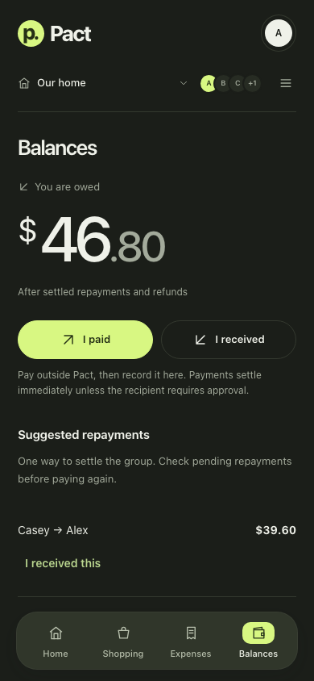
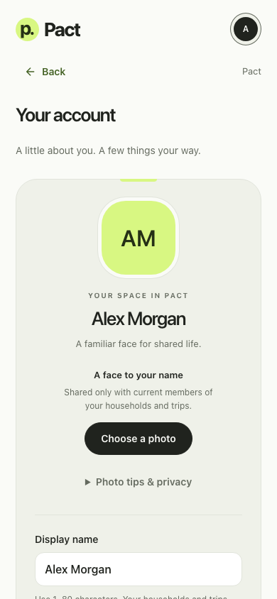
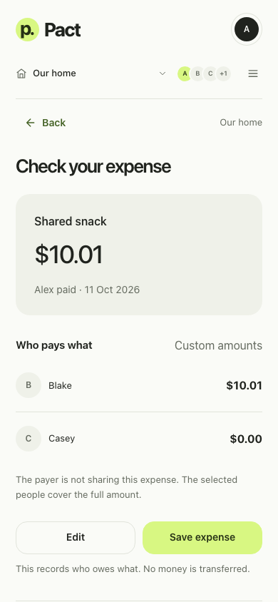
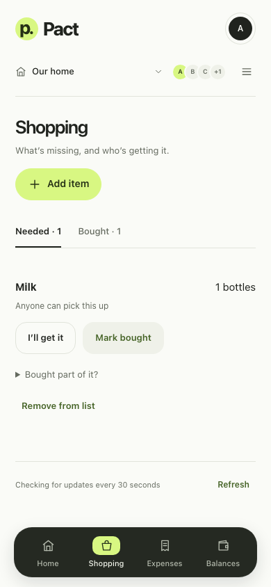

# Pact

**Shared expenses, shopping and trips. Made for the everyday reality of living together.**

[](https://github.com/erankawinda/pact/actions/workflows/ci.yml)

Pact started as a fun personal project to solve a real problem I encountered while living in a shared house: keeping shared spending fair and remembering what needed buying. Some purchases involve everyone; others involve just a few people, or someone paying on another person's behalf.

Pact brings those small decisions together: record what happened, choose who shares the cost, and see what needs doing next.

Built with **React, TypeScript, Vite and Supabase**. Designed for phones, with warm-white and charcoal themes, lime accents, clear balances and a floating navigation bar.

**Current release: [0.4.0-preview.6](docs/RELEASE-0.4.0-PREVIEW.6.md).** The production frontend and private photo backend were verified on **11 October 2026**. Transaction notifications remain an optional staging feature; delivery to a real phone is not yet verified.

[Set up a development copy](docs/DEPLOYMENT.md) · [Architecture](docs/ARCHITECTURE.md) · [Verification status](docs/STATUS.md) · [Roadmap](docs/ROADMAP.md)

## A look inside

Matching phone-sized previews of the current interface. All people and transactions are fictional and generated by the local tests. Select an image for a larger view.

<table>
  <tr>
    <th width="50%" align="center" scope="col">Clear balances</th>
    <th width="50%" align="center" scope="col">Your space in Pact</th>
  </tr>
  <tr>
    <td align="center" valign="top"><a href="docs/images/balances-dark.png"></a></td>
    <td align="center" valign="top"><a href="docs/images/profile-light-preview.png"></a></td>
  </tr>
  <tr>
    <td align="center">Record money sent or received.</td>
    <td align="center">Your photo, name and preferences.</td>
  </tr>
  <tr>
    <th align="center" scope="col">Review before saving</th>
    <th align="center" scope="col">Shared shopping</th>
  </tr>
  <tr>
    <td align="center" valign="top"><a href="docs/images/expense-review.png"></a></td>
    <td align="center" valign="top"><a href="docs/images/shopping-needed.png"></a></td>
  </tr>
  <tr>
    <td align="center">Check every share before it counts.</td>
    <td align="center">See what is needed and who is getting it.</td>
  </tr>
</table>

## What you can do

| Feature | Everyday use |
|---|---|
| Shared expenses | Choose the payer and participants, split equally or enter exact shares, and calculate missing amounts before reviewing. |
| Balances and repayments | Record **I paid** or **I received**. New repayments settle automatically by default; each recipient can require approval for future incoming reports. |
| Shared shopping | Add quantities, claim an item, record partial purchases and turn purchases into expenses. |
| Households and trips | Invite people with Google sign-in, manage membership and keep selected trip participants and costs separate. |
| Personal profiles | Edit your display name, add a private photo and choose System, Light or Dark appearance on each browser. |
| Corrections and history | Correct or void expenses, record refunds and reverse confirmed repayments while retaining history. |
| Exports and recovery | Export the group ledger as CSV/JSON, retain drafts and reconcile an interrupted save without recording it twice. |

**Pact records repayments; it does not transfer money.** Approval preferences do not retroactively settle existing pending records.

Profile photos are visible only to the owner and current members of a shared household or trip. The original stays on the device: Pact prepares a square preview and uploads a processed JPEG of at most **512 × 512 pixels / 256 KiB**. A saved photo must be deleted before adding a replacement. See the [photo guide](supabase/functions/profile-photo/README.md) for access rules, limits and recovery.

**In staging:** opt-in transaction notifications for involved recipients, with category choices and Friendly/Brief tone. Lock-screen text excludes names and amounts. This code is included but disabled in the current production build; [server setup and real-device validation](docs/DEPLOYMENT.md#upgrade-to-040-preview5) are separate steps.

## Run locally

Use Node.js **22.12 or later** (`.nvmrc` selects Node 22).

```sh
git clone https://github.com/erankawinda/pact.git
cd pact
npm ci
cp .env.example .env.local
```

Create your own development Supabase project and follow the [database and deployment guide](docs/DEPLOYMENT.md) and [Google sign-in setup](docs/GOOGLE-SETUP.md). Put your project's URL and **publishable** key in `.env.local`, then run:

```sh
npm run dev -- --host localhost
```

Open `http://localhost:5173`. Without backend configuration, Pact shows a setup message. Photo and notification flags default to disabled until their own backend setup is validated. Automated tests run independently of a hosted project.

Frontend environment values are visible to browser users. Never put database passwords, service-role keys, OAuth secrets, a VAPID private key or a dispatcher token in frontend files.

## Verify changes

```sh
npm run check
npx playwright install chromium
npm run test:browser
npm run test:privacy-browser
npm run test:notifications-browser
```

`check` runs the public privacy gate, Node tests, TypeScript and the production build. Database tests apply the actual migrations in disposable PGlite databases. Browser tests use fictional accounts, intercept external traffic and run accessibility checks with axe.

The preview.6 source passed **61 Node tests, 41 browser scenarios and 7 notification-worker runtime tests** in [GitHub Actions](https://github.com/erankawinda/pact/actions/runs/38130776233). CI also checks both Edge Function entrypoints. See [QA instructions](qa/README.md) and the [worker guide](supabase/functions/dispatch-notifications/README.md) to reproduce these checks.

Hosted staging validated photo processing, access control, upload/read/delete and cleanup. Production files match the reviewed release bundle. These checks do not certify a real production-account photo upload, native phone notifications, screen-reader use, concurrent database sessions or backup restoration. Independent two-account acceptance was skipped for the earlier preview.2 release. See the dated [verification record](docs/STATUS.md).

## Project structure

```text
src/                    React screens, profiles, navigation, sync and money helpers
public/                 App icons, web manifest, push worker and hosting headers
supabase/migrations/    Schema, access rules and validated database operations
supabase/functions/     Private photo service and notification dispatcher
tests/                  Money, workflow, database, privacy and service tests
qa/                     Isolated browser and accessibility checks
docs/                   Architecture, setup, releases, screenshots and roadmap
.github/workflows/      Automated verification
```

Amounts are stored as integer cents. The database enforces household access; request identifiers make supported writes safe to retry. Private photos use authenticated server access. The optional push worker adds no offline transaction queue or page cache. The app currently uses AUD and Melbourne time.

## Contributing and privacy

Keep changes focused and validate them in a separate development environment. [CONTRIBUTING.md](CONTRIBUTING.md) covers meaningful commits and checks; [SECURITY.md](SECURITY.md) explains private reporting and publication safeguards.

This repository contains project source and synthetic examples only. Real household records, contacts, invitations, configured deployment bundles, private photos and credentials are excluded. Public screenshots are visually reviewed and hash-checked before publication.

Receipt attachments, recurring bill templates, monthly reports and an import/restore flow are planned, not implemented. JSON export is a group snapshot, not a complete database/Auth/Storage backup. Follow the [roadmap](docs/ROADMAP.md) for the next work.
