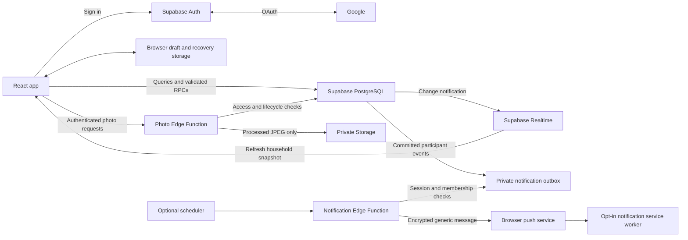

# Architecture

Pact keeps the interface in a static React application and the shared records and permissions in PostgreSQL. Private profile photos and optional transaction notifications use narrowly scoped Supabase Edge Functions. The frontend is still deployed as static files.

## Source map

| Area | Responsibility |
|---|---|
| `src/App.tsx`, `src/navigation.ts` | Session state, screens and browser history |
| `src/api.ts`, `src/useHousehold.ts` | Supabase connection, snapshots, refresh and Realtime subscriptions |
| `src/AccountProfile.tsx`, `src/profile.ts` | Own display name, account details, repayment preference and device appearance |
| `src/ProfilePhoto.tsx`, `src/photoApi.ts`, `src/photoProcessing.ts`, `src/PhotoContext.tsx` | Local photo preview/processing, authenticated requests and account-scoped image blobs |
| `src/NotificationSettings.tsx`, `src/notifications.ts`, `public/push-sw.js` | Device opt-in, categories/tone, account binding and notification navigation |
| `supabase/functions/` | Authenticated photo processing/Storage and scheduled notification dispatch |
| `src/ExpenseForm.tsx`, `src/money.ts` | Expense entry, whole-cent parsing and equal/exact splits |
| `src/pendingExpense.ts`, `src/useMutation.ts` | Store a request before sending; retry the same operation after an uncertain response |
| `src/Shopping.tsx`, `src/HouseholdViews.tsx` | Shared shopping, expense history, balances and repayments |
| `src/Management.tsx`, `src/GroupForms.tsx`, `src/invitations.ts` | Households, trips, invitations and member administration |
| `src/export.ts` | CSV and JSON group exports |
| `supabase/migrations/` | Schema, row-level access rules, RPCs and financial invariants |
| `tests/`, `qa/` | Unit/database tests and isolated browser scenarios |

## Shared data and access

A group is either a household or a trip under a household. Membership records carry an organiser/member role and active/revoked status. Trip membership is limited to selected household members; household access also gates linked trip access.

Google identities create profile records. Personal invitation tokens are stored as hashes and tied to an intended email address, with expiry and revocation. A signed-in user must accept a matching invitation before joining.

An own-name update RPC derives its target from the verified session, never a supplied user ID. Profile names remain visible to authorised co-members; private account emails and appearance choices are not added to shared profile rows. Names can change in history displays, while ledger references keep their immutable user IDs. Appearance is stored on the device and can follow the operating system.

Readable tables use row-level security. Clients cannot write financial and workflow tables directly; public RPC wrappers call private functions that check identity, membership, role and input before a transaction commits. The database, rather than hidden buttons, enforces permission decisions.

## Money and history

Amounts use integer cents. Equal splits distribute leftover cents deterministically; exact splits must sum to the total. The current product uses AUD and Melbourne dates.

Custom splits keep manual values separate from calculated shares. One unknown share receives the remainder; several unknown shares require the explicit equal-remainder choice. An entered zero is fixed, while a blank is unknown. Review freezes the resulting integer shares, so interrupted saves retry the same request rather than recalculating against a newer draft.

Balances are derived from posted expenses and shares, refunds and confirmed repayments. Sender-recorded repayments settle automatically by default. If the recipient has enabled approval, new reports start pending and affect balances only after the recipient confirms. Existing pending records are not changed by a preference switch. Recipients can also record money already received: the session fixes the recipient, and that record is confirmed immediately. Amounts may be partial; the app does not cap transfers to a suggested balance or move money.

A recipient cannot create another repayment while any pending record exists from the selected sender in that group. They must explicitly confirm or reject the pending report first. Both recording directions also check for a pending or confirmed record with the same group, sender, recipient, amount and date. A deliberate **This is a separate payment** acknowledgement allows distinct transfers with identical details; it cannot bypass the recipient's pending-record check. Different dates or amounts are not automatically treated as duplicates.

The `record_repayment` RPC and compatible `record_payment` RPC use the same insert helper. A transaction advisory lock serialises each directed participant pair, including when no payment row exists yet. Payment actions acquire that pair lock before locking their row. Request replay runs before these checks, so checking an uncertain save returns its earlier result without creating a second record. The old RPC retains its signature and original request hash; new exact duplicates are rejected, and older clients cannot override that guard.

`recorded_by` identifies the participant who entered a payment; the migration backfills existing rows with their sender. Receipt activity identifies the recipient as the actor. Confirmed payments can be reversed by their recipient or an organiser, with a reason, while preserving history. Corrections retain the voided original expense and create a replacement; refunds are bounded by the refundable amount.

Request IDs and stored operation results let supported mutations reconcile a retry without applying the same request twice. Version checks detect edits based on stale state. Local tests exercise these rules, but they do not certify races across independent PostgreSQL connections.

## Synchronisation and browser storage

Realtime notifications trigger a fresh household snapshot. The app also refreshes on focus, visibility changes, reconnect and every 30 seconds while visible and online. The database remains authoritative; the client does not merge an offline ledger.

Expense drafts and pending operations use browser local storage, scoped to the user and group. Invitation and sign-in return state use session storage. Losing browser data can lose an unfinished draft or recovery request, so storage is not a backup. A network timeout does not prove a write failed; use the existing recovery action before entering the same expense again.

## Hosting and scope

Vite emits static files for hosting. The manifest and icons support a Home Screen shortcut with standalone presentation. When notifications are enabled, a service worker handles push and notification taps; it does not cache pages or queue offline transactions.

A Supabase URL, publishable key, feature flags and optional VAPID public key belong in the frontend build. Google secrets, privileged Supabase keys, the VAPID private key and dispatcher token stay outside it. The checked-in headers assume hosted `*.supabase.co` endpoints.

JSON export is a group snapshot, not a restorable database/Auth/Storage backup. Receipt attachments, reports and other deferred features are tracked in [ROADMAP.md](ROADMAP.md).

### Payment preferences

The verified caller reads and updates only their own global `require_payment_approval` preference through RPCs with no target-user argument. It defaults to false. Household snapshots expose this preference to authorised co-members so the sender sees the applicable rule. Recording locks the recipient profile while deciding between automatic settlement and pending approval. `confirmation_method` distinguishes automatic settlement from receipt acknowledged by the recipient; reversal retains this attribution. Existing payment amounts, statuses and participants are not changed by the preference migration.

## Private profile photos

The browser validates source type, dimensions and size, then prepares a square JPEG preview before asking the user to save. Original files stay on the device. The Edge service verifies the caller with gateway JWT checking and Auth `getUser`, accepts only a bounded JPEG, decodes and re-encodes fresh pixels, and stores it in a private bucket. The browser cannot call Storage or the lifecycle RPC directly.

A service-only lifecycle operation derives the owner from the verified Auth response. Each photo has an immutable generation and object path; upload reservations, stable request identifiers and version-bound deletion make retries safe. A ready photo must be deleted through the Storage API before another can be saved. An unfinished upload may remain private until the owner returns or maintenance cleans it up.

Authenticated reads check current shared-household/trip membership before and after fetching the object. A trip also requires active membership in its parent household. Responses are `private, no-store`, without public or signed URLs. The frontend renders short-lived blob URLs scoped to the account and current group state, and clears them on context changes and refresh. This access model cannot recall a photo someone has already seen or copied.

## Optional transaction notifications

Database triggers enqueue committed expense, refund and repayment events for involved participants, excluding the actor. Corrections include the prior and new participant sets. Private preferences, device subscriptions and outbox rows are not directly browser-readable. Registration binds a device to the verified account/session; delivery rechecks session validity, membership and preferences.

A scheduler invokes the dispatcher with a server-only token. It claims queued deliveries, encrypts generic text for the browser push endpoint, retries temporary failures and disables expired endpoints. Categories and Friendly/Brief tone are configurable; payloads contain no names, amounts, household details or photos. Account switches clear the local binding and subscription. Tapping a notification resolves the destination only after access is checked again.

Push is best effort: provider acceptance does not prove phone display, and a crash after acceptance may cause a retry. Native device delivery remains an acceptance step. Photos and notifications have independent build flags and server setup; the current production release enables photos only. See the [service guides](../supabase/functions/) and [deployment guide](DEPLOYMENT.md).
